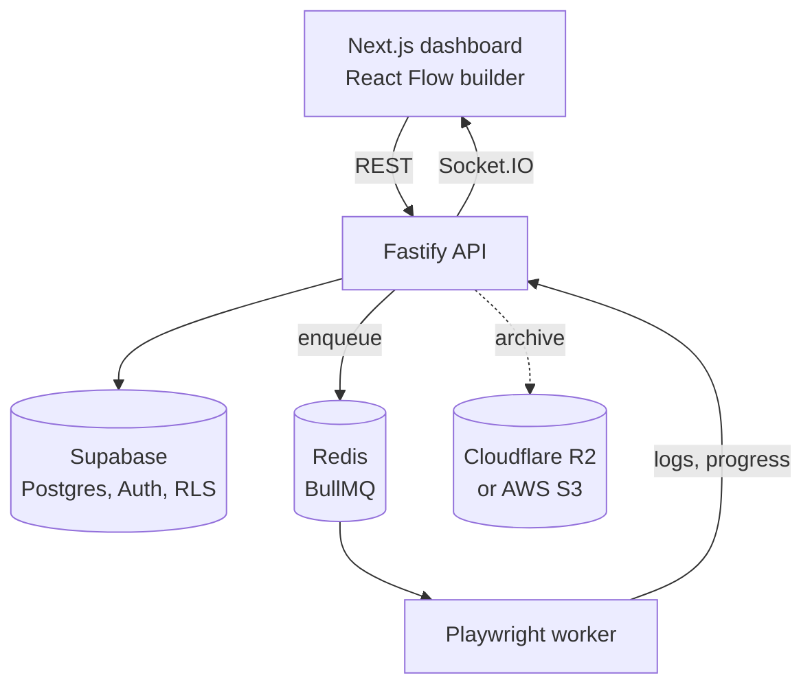

# AutoFlow Pro

Browser automation platform: drag steps onto a canvas, a Playwright worker runs them, and logs stream live.


*Recorded against a local stack (Supabase CLI, Redis in Docker, a test page served from the same machine). It plays at 2x except for the live run.*

[](https://github.com/Exalt24/autoflow-pro/actions/workflows/ci.yml) **Proof:** 23 step types, 32 backend test scripts, and CI that builds both the backend and the frontend on every push and runs the AWS S3 archive target against a local AWS emulator.

It runs locally with Docker and Node, and the recording above is one such run.

## What it is and why

You build a workflow out of steps (navigate, click, fill, extract, loops, conditionals), and a BullMQ queue hands it to a Playwright worker. A WebSocket pushes logs and progress to the dashboard as it runs. Jobs can run on a cron schedule and pause themselves after consecutive failures. Every row is scoped to its owner with Supabase Row Level Security. I built it to wire a visual editor, a job queue and a browser worker into one product end to end.

## What it does

- Visual builder with React Flow and 23 step types: navigate, click, fill, extract, wait, screenshot, scroll, hover, key press, run JavaScript, conditional, loop, variables, file download, drag and drop, cookies, localStorage, dropdown, right and double click.
- Cron scheduling with presets and failure monitoring.
- Live monitoring over Socket.IO with automatic reconnection.
- Analytics: execution trends, success rates, error analysis.
- Optional archival of old executions to Cloudflare R2 (the default) or AWS S3, chosen with `ARCHIVE_PROVIDER`; it stays off until the matching settings are present.

## Architecture



## Run it

```bash
docker compose up -d redis
# a local Supabase stack, then the migration backend/migrations/001_initial_schema.sql (see docs/LOCAL_SETUP.md)
cd backend && npm install && npx playwright-core install chromium && cp .env.example .env && npm run dev
cd ../frontend && npm install && cp .env.example .env.local && npm run dev
```

Open http://localhost:3000 and sign up (a local Supabase has email confirmation off). The Supabase steps, env values and a sample workflow are in [docs/LOCAL_SETUP.md](docs/LOCAL_SETUP.md). More: [API](docs/API.md), [user guide](docs/USER_GUIDE.md), [deployment](docs/DEPLOYMENT.md), [troubleshooting](docs/TROUBLESHOOTING.md).

## Tests

CI runs `npm ci` and `npm run build` for the backend and the frontend, plus `npm run test:pipelines`. A fourth job, `aws-emulator`, starts moto, applies the Terraform in `deploy/aws` to it, runs the archive tests and destroys it again. The 32 scripts in `backend/tests/` run with `tsx` (for example `npm run test:queue`, `npm run test:api`), print their results, and most run against a local Supabase and Redis. The frontend is checked with `npm run lint` and `npx tsc --noEmit`.

## CI and deploy targets

Each target below ships as a config file and was run against the thing named beside it. The captured output of every run is in [docs/test-runs](docs/test-runs).

| Target | Files | Run against | Result |
| --- | --- | --- | --- |
| GitHub Actions | `.github/workflows/ci.yml` | GitHub Actions on every push | backend, frontend, pipelines and aws-emulator jobs |
| GitLab CI | `.gitlab-ci.yml` | `gitlab-ci-local` 4.77.0 with the Docker executor and the `node:22` image | all three jobs passed in 37 s, [output](docs/test-runs/2026-10-30-gitlab-ci-local.txt) |
| Azure Pipelines | `azure-pipelines.yml` | the official Azure Pipelines JSON schema (v1.261.1, kept in `scripts/schemas`) checked with ajv | schema check passed, [output](docs/test-runs/2026-10-30-pipeline-parity-and-azure-schema.txt) |
| Netlify | `netlify.toml` | `npx netlify-cli build --offline` (netlify-cli 27.16.1) on this machine | the Next.js build and the server handler packaging completed, [output](docs/test-runs/2026-10-30-netlify-build.txt) |
| Google Cloud Run | `backend/Dockerfile`, `deploy/cloudrun/service.yaml` | `docker build` and `docker run` of the image as a local container next to a Redis container | `GET /health` answered 200 on port 8080, image 483 MB, runs as the `node` user, [output](docs/test-runs/2026-10-30-cloud-run-container.txt) |
| AWS S3 | `deploy/aws/` (Terraform), `backend/src/config/archiveTarget.ts` | `terraform apply` and `terraform destroy` against a local AWS emulator (moto 5.2.5, AWS provider 6.71.0), then the backend archive code and `ArchivalService` signed in as the IAM user Terraform created, with moto's IAM checks on | 34 emulator checks, 30 provider switch checks and 19 Terraform plan checks passed, 20 of 20 deliberately broken rules were caught, the bucket answered 404 after destroy, [output](docs/test-runs/2026-10-31-aws-s3-moto-terraform.txt) |
| AWS S3 (AWS account) | `deploy/aws/` (Terraform) | `terraform apply` and `terraform destroy` against an AWS account in ap-southeast-2 (AWS provider 6.71.0), then signed requests as the IAM user Terraform created | 9 resources created, the bucket's settings read back from AWS, the user wrote and read under `executions/` and got 403 for another prefix, the bucket settings and an unprefixed list, then 9 destroyed and the bucket answered 404, [output](docs/test-runs/2026-10-31-aws-s3-real-account.txt) |

The archive target is one setting. It defaults to R2, so nothing existing changes. For S3 the same client code uses the AWS region and the SDK's own endpoint resolution, and `AWS_S3_ENDPOINT` points it at an emulator:

```bash
ARCHIVE_PROVIDER=s3
AWS_REGION=ap-southeast-2
AWS_S3_BUCKET_NAME=autoflow-archive-123456789012
```

`deploy/aws/` creates the bucket (public access blocked, versioned, AES256 encrypted, archives expire after 90 days) and an IAM user whose policy covers the `executions/` prefix only; its README has the commands for a real account and for moto. In the moto run that user could write, read, list and delete under `executions/`, and put, get and delete-version elsewhere in the bucket were refused with 403. In the AWS account run the same user wrote, read and listed under `executions/` and was refused for another prefix, for the bucket settings and for a list with no prefix. The Terraform checks read the plan JSON for each rule, and [the mutation log](docs/test-runs/2026-10-31-aws-s3-mutation-check.txt) shows each rule broken in a scratch copy and the matching test going red.

`npm run test:pipelines` keeps the three pipelines in step. It reads the GitHub, GitLab and Azure files and checks that each job runs the same commands in the same folders with the same environment and Node 22, then validates the Azure file against the schema. It also runs as the `pipelines` job in all three CI files.

The Cloud Run image runs the API on the `PORT` Cloud Run provides. The Playwright worker reaches its browser through `BROWSER_WS_URL`, the remote browser setting the engine already supports. Secrets (Supabase, Redis) are read from Secret Manager references in `service.yaml`, and the Netlify site takes the two `NEXT_PUBLIC_SUPABASE_*` values from its settings.

## Next steps

- The API rate limit is 100 requests per 15 minutes per client, counted in the backend process; a shared store for the counter is next, and restarting the backend clears it meanwhile.
- The usage view shows per-user quota rows (10 workflows, 50 executions a month by default); enforcing them in the backend is next.
- The data model is per-user rows with RLS; organizations and workspaces are next.
- The tests are scripts today; moving them into a test framework that CI runs is next.

## Stack

Next.js 16, React 19, TypeScript, Tailwind CSS 4, React Flow, Recharts, Fastify 5, Playwright, BullMQ, Socket.IO, Supabase, Redis, Cloudflare R2, AWS S3, Terraform. When hosted it ran on free tiers (Vercel, Render, Supabase, Upstash).

## License

MIT, see [LICENSE](LICENSE). By Daniel Alexis Cruz, [dacruz.vercel.app](https://dacruz.vercel.app).
