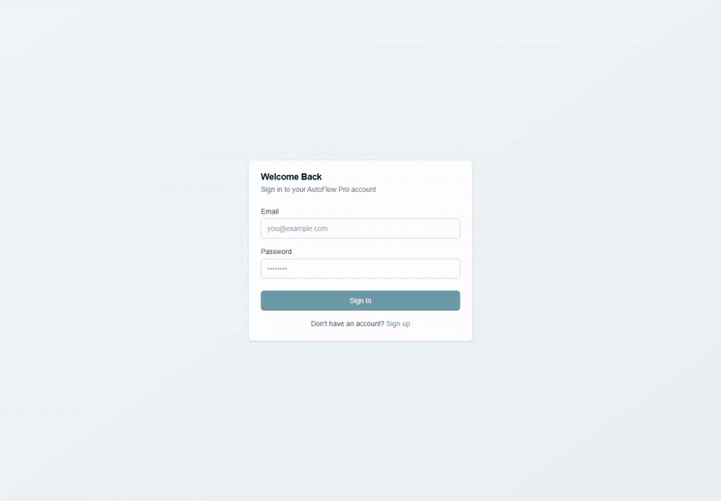
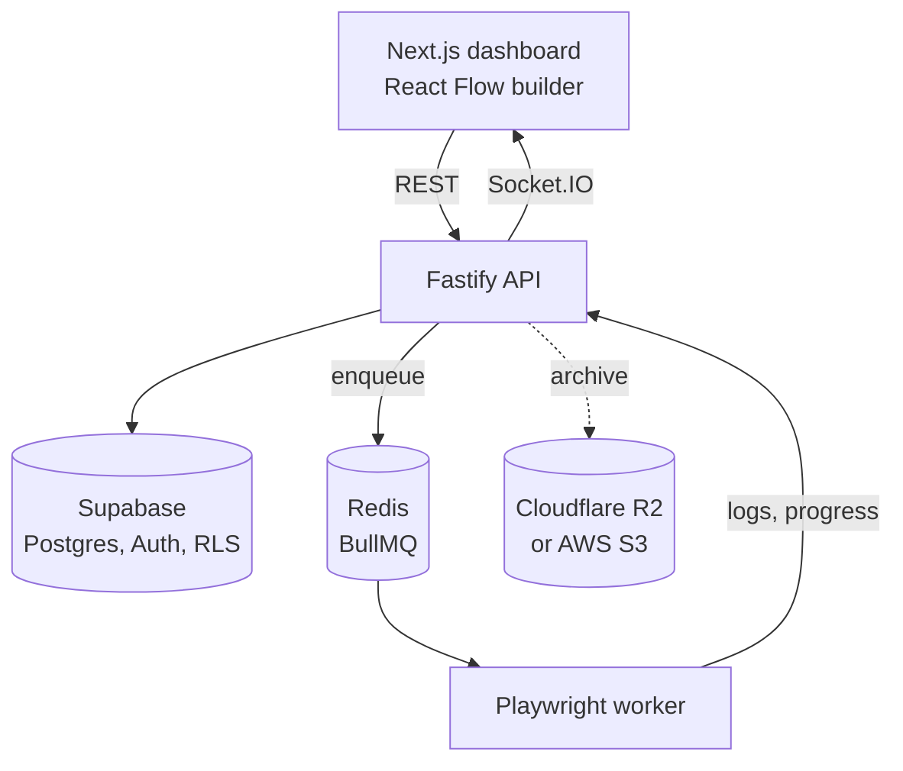

# AutoFlow Pro

Browser automation platform: drag steps onto a canvas, a Playwright worker runs them, and logs stream live.



*Recorded against a local stack (Supabase CLI, Redis in Docker, a test page served from the same machine). It plays at 2x except for the live run.*

[](https://github.com/Exalt24/autoflow-pro/actions/workflows/ci.yml) **Proof:** 23 step types and 46 backend test scripts. CI builds the backend and the frontend on every push. It runs the AWS S3 archive target against a local AWS emulator, the RabbitMQ consumer and the telemetry worker against a real broker, the Terraform and Helm files and the Athena client against a stand-in API, the Temporal workflow, the GraphQL API, the Rust CLI, a Nixpacks build, a Python order pipeline against moto and the Supabase Edge Functions against a local stack.

It runs locally with Docker and Node, and the recording above is one such run.

## What it is and why

You build a workflow out of steps (navigate, click, fill, extract, loops, conditionals), and a BullMQ queue hands it to a Playwright worker. A WebSocket pushes logs and progress to the dashboard as it runs. Jobs can run on a cron schedule and pause themselves after consecutive failures. Every row is scoped to its owner with Supabase Row Level Security. I built it to wire a visual editor, a job queue and a browser worker into one product end to end.

## What it does

- Visual builder with React Flow and 23 step types. The types are navigate, click, fill, extract, wait, screenshot, scroll and hover. They also include key press, run JavaScript, conditional, loop and variables. The last are file download, drag and drop, cookies, localStorage, dropdown, and right and double click.
- Cron scheduling with presets and failure monitoring.
- Live monitoring over Socket.IO with automatic reconnection.
- Analytics: execution trends, success rates, error analysis.
- Optional archival of old executions to Cloudflare R2 (the default) or AWS S3, chosen with `ARCHIVE_PROVIDER`. It stays off until the matching settings are present.
- A Supabase Edge Function, `execution-summary` (Deno, `supabase/functions/`), returns a signed-in user's execution counts per workflow. It builds its client from the caller's own token and the anon key, so the same row level security policy that guards the tables decides which rows it can read. Tests and the run are in the table below.
- GDPR data subject requests (data export, account erasure, log retention) tested with two users on a local Supabase stack.

## Architecture



## Run it

```bash
docker compose up -d redis
# a local Supabase stack, then the migration backend/migrations/001_initial_schema.sql (see docs/LOCAL_SETUP.md)
cd backend && npm install && npx playwright-core install chromium && cp .env.example .env && npm run dev
cd ../frontend && npm install && cp .env.example .env.local && npm run dev
```

Open http://localhost:3000 and sign up (a local Supabase has email confirmation off). The Supabase steps, env values and a sample workflow are in [docs/LOCAL_SETUP.md](docs/LOCAL_SETUP.md). More: [API](docs/API.md), [user guide](docs/USER_GUIDE.md), [deployment](docs/DEPLOYMENT.md), [troubleshooting](docs/TROUBLESHOOTING.md).

## Tests

CI runs `npm ci` and `npm run build` for the backend and the frontend, plus `npm run test:pipelines`. A fourth job, `aws-emulator`, starts moto, applies the Terraform in `deploy/aws` to it, runs the archive tests and destroys it again. The 46 scripts in `backend/tests/` run with `tsx` (such as `npm run test:queue`), print their results, and most run against a local Supabase and Redis. The frontend is checked with `npm run lint` and `npx tsc --noEmit`.

- A GitHub Copilot CLI review found `0` and `false` read as empty in `conditionEvaluator.ts`. [Fix and run](docs/test-runs/2026-11-27-copilot-cli-review.txt).

## Personal data (GDPR) notes

| Right | How it is handled | Test that proves it |
| --- | --- | --- |
| Access and portability (Articles 15, 20) | `export-my-data` Edge Function: one JSON download, filtered by row level security | `backend/tests/test-gdpr.ts` Part A: A's export holds A's rows and none of B's. Part B: the service role client swapped in turns it red |
| Erasure (Article 17) | `delete-my-account`: the user comes from the token, with a typed confirmation; files, the auth user and cascaded rows go, Auth's event log is scrubbed, an audit row holds no personal data | Part D: a user who names B erases only themselves; after A is erased no table holds A's id or email |
| Storage limitation (Article 5(1)(e)) | `purge_old_execution_logs(90)`, run daily by pg_cron | Part C: backdated rows are removed or kept as the cutoff says |

This project supports a controller's obligations. It is not a certification of compliance, and the legal texts (privacy policy, terms, cookie consent) must be written and approved by a lawyer. Run on a local stack only; no frontend page calls the functions yet. [Details](docs/ci-and-deploy-details.md#personal-data-gdpr-handling).

## CI and deploy targets

Each target below ships as a config file and was run against the thing named beside it. The captured output of every run is in [docs/test-runs](docs/test-runs).

| Target | Files | Run against | Result |
| --- | --- | --- | --- |
| GitHub Actions | `.github/workflows/ci.yml` | GitHub Actions on every push | backend, frontend, pipelines and aws-emulator jobs |
| GitLab CI | `.gitlab-ci.yml` | `gitlab-ci-local` 4.77.0 with the Docker executor and the `node:22` image | all three jobs passed in 37 s, [output](docs/test-runs/2026-10-30-gitlab-ci-local.txt) |
| Azure Pipelines | `azure-pipelines.yml` | the official Azure Pipelines JSON schema (v1.261.1, kept in `scripts/schemas`) checked with ajv | schema check passed, [output](docs/test-runs/2026-10-30-pipeline-parity-and-azure-schema.txt) |
| Netlify | `netlify.toml` | `npx netlify-cli build --offline` (netlify-cli 27.16.1) on this machine | the Next.js build and the server handler packaging completed, [output](docs/test-runs/2026-10-30-netlify-build.txt) |
| Google Cloud Run | `backend/Dockerfile`, `deploy/cloudrun/service.yaml` | `docker build` and `docker run` of the image as a local container next to a Redis container | `GET /health` answered 200 on port 8080, image 483 MB, runs as the `node` user, [output](docs/test-runs/2026-10-30-cloud-run-container.txt) |
| AWS S3 | `deploy/aws/` (Terraform), `backend/src/config/archiveTarget.ts` | `terraform apply` and `terraform destroy` against a local AWS emulator (moto 5.2.5, AWS provider 6.71.0), then the backend archive code and `ArchivalService` signed in as the IAM user Terraform created, with moto's IAM checks on | 34 emulator checks, 30 provider switch checks and 19 Terraform plan checks passed, 20 of 20 deliberately broken rules were caught, the bucket answered 404 after destroy, [output](docs/test-runs/2026-10-31-aws-s3-moto-terraform.txt) |
| AWS S3 (AWS account) | `deploy/aws/` (Terraform) | `terraform apply` and `terraform destroy` against an AWS account in ap-southeast-2 (AWS provider 6.71.0), then signed requests as the IAM user Terraform created | 9 resources created, the bucket's settings read back from AWS, the user wrote and read under `executions/` and got 403 for another prefix, the bucket settings and an unprefixed list, then 9 destroyed and the bucket answered 404, [output](docs/test-runs/2026-10-31-aws-s3-real-account.txt) |
| AWS EKS | `deploy/eks/` (Terraform) | `terraform validate`, an offline `terraform plan` with dummy credentials (AWS provider 6.72.0), then applied for real on my own AWS account and destroyed | the VPC, an EKS cluster and a two node managed node group came up and ran (nodes Ready, coredns, kube-proxy and the CNI running), 26 resources destroyed and read back gone; the IAM OIDC provider and IRSA role were blocked by an organization policy on that account; 29 resources planned, 89 deploy file checks passed, 13 of 13 deliberate breaks caught, [plan output](docs/test-runs/2026-11-07-eks-terraform-and-helm.txt), [apply output](docs/test-runs/2026-11-07-eks-apply.txt) |
| Kubernetes (Helm) | `deploy/helm/autoflow-pro/` | `helm lint --strict`, `helm template`, `kubeconform` against Kubernetes 1.34, then a Helm install on a local kind cluster (Kubernetes 1.37) with the real backend image | 9 of 9 objects valid, API and worker pods Ready, [kind run](docs/test-runs/2026-11-07-kind-cluster.txt) |
| RabbitMQ | `backend/src/messaging/` | a real RabbitMQ 3.13.7 and Redis 7 in Docker | 41 logic checks and 38 broker checks passed, 4 of 4 deliberate breaks caught, [output](docs/test-runs/2026-11-07-rabbitmq-consumer.txt) |
| Athena | `backend/src/athena/`, `deploy/athena/` (Terraform) | the real AWS SDK against a stand-in Athena API written from the API reference, then `terraform validate` and an offline `terraform plan` with dummy credentials, never applied | 37 checks against the stand-in, 45 logic and property checks over 3000 seeded worlds, 12 resources planned, 33 plan rules, 52 of 52 deliberate breaks caught, [output](docs/test-runs/2026-11-07-athena-client.txt) |
| Telemetry | `backend/src/telemetry/`, `deploy/athena/telemetry.tf` (Terraform) | generated solar telemetry on a local filesystem and a real RabbitMQ 3.13.7 broker in Docker; the Athena Terraform validated and planned offline with dummy credentials | 160 logic and property checks over 400 seeded worlds, 21 end to end, 48 Terraform plan and 22 broker checks passed, 101 of 101 deliberate breaks caught, 1,023,000 readings through ingest and rollup in 1.25 s (821,245 per second), [output](docs/test-runs/2026-11-07-telemetry-tests.txt), [load run](docs/test-runs/2026-11-07-telemetry-load.txt) |
| Temporal | `backend/src/temporal/` | the SDK's time-skipping test server, then a real local `temporal server start-dev` with a real worker; not Temporal Cloud, no cluster; the step executor is a dry run | `npm run test:temporal` 31 checks, `npm run test:temporal-e2e` 12 checks, 19 of 19 deliberate breaks caught on the test server and 6 of 6 on the dev server, [output](docs/test-runs/2026-11-07-temporal-tests.txt), [breaks](docs/test-runs/2026-11-07-services-mutation-check.txt) |
| GraphQL | `backend/src/graphql/` | the real Yoga on Fastify server over HTTP with an in-memory run store, and driving a real worker on the Temporal dev server; no authentication | `npm run test:graphql` 42 checks, `npm run test:graphql-temporal` 9 checks, 29 of 29 deliberate breaks caught, [output](docs/test-runs/2026-11-07-graphql-tests.txt) |
| Rust CLI | `cli/` | `cargo test` against a mock GraphQL server, then the binary against the local GraphQL and Temporal servers | fmt and `clippy -D warnings` clean, 14 unit and 17 mock server tests passed, 9 of 9 deliberate breaks caught, [tests](docs/test-runs/2026-11-07-rust-cli.txt), [real run](docs/test-runs/2026-11-07-rust-cli-against-graphql.txt) |
| Nixpacks | `backend/nixpacks.toml`, `scripts/nixpacks-*.sh` | `nixpacks build` 1.41.0 on this machine, not Railway | with no config it chose Node 18 and the container crashed at start; with Node 22 pinned `GET /health` answered 200, [output](docs/test-runs/2026-11-07-nixpacks-build.txt) |
| AWS serverless order pipeline | `serverless/` (Python), `.github/workflows/serverless.yml` | moto 5.2.5 running inside pytest, plus stand-ins for a payment provider, a carrier and Bedrock; written from the AWS documentation, not deployed to Lambda | SQS with a dead-letter queue, DynamoDB conditional writes, a Step Functions saga and a Bedrock Converse client (details in [docs](docs/ci-and-deploy-details.md#tfgraph-and-the-serverless-order-pipeline)); about 460 tests and 50 of 50 deliberate breaks caught, [output](docs/test-runs/2026-11-17-serverless-order-pipeline.txt) |
| Supabase Edge Function | `supabase/functions/execution-summary/`, `backend/tests/test-edge-function.ts` | a local Supabase stack (CLI 3.4.0, edge runtime on Deno 2.1.4) with two users signed in through Supabase Auth; not a hosted project | 38 checks passed, including a deliberate break (the service role client swapped in) that leaked and was caught, [output](docs/test-runs/2026-11-27-supabase-edge-function.txt), [notes](docs/ci-and-deploy-details.md#supabase-edge-function) |
| GDPR data subject requests | `supabase/functions/export-my-data/`, `supabase/functions/delete-my-account/`, `backend/tests/test-gdpr.ts` | the same local Supabase stack with three signed in users; not a hosted project | 75 checks passed, including a deliberate break (the service role client swapped in) that leaked B's rows into A's export and was caught, [output](docs/test-runs/2026-11-27-gdpr-data-subject-requests.txt) |

The archive target is one setting, `ARCHIVE_PROVIDER`, and it defaults to R2 so nothing existing changes. Notes on the S3 and EKS Terraform, Athena, telemetry, Temporal, GraphQL, the Rust CLI, RabbitMQ and Cloud Run are in [docs/ci-and-deploy-details.md](docs/ci-and-deploy-details.md).

The tfgraph plan checker and the order pipeline are described in [docs](docs/ci-and-deploy-details.md#tfgraph-and-the-serverless-order-pipeline).

## Next steps

- The API rate limit is 100 requests per 15 minutes per client, counted in the backend process. A shared store for the counter is next.
- The usage view shows per-user quota rows (10 workflows, 50 executions a month). Enforcing them is next.
- The data model is per-user rows with RLS. Organizations and workspaces are next.
- The tests are scripts today. A test framework that CI runs is next.

## Stack

Next.js 16, React 19, TypeScript, Tailwind CSS 4, React Flow, Recharts, Fastify 5, Playwright, BullMQ, Socket.IO, Supabase (Postgres, Auth, Row Level Security, Edge Functions in Deno and pg_cron) and Redis. Storage and messaging add Cloudflare R2, AWS S3 and RabbitMQ. Infrastructure is Terraform, Kubernetes (EKS), Helm, Traefik, Amazon Athena and Glue. The rest is Temporal, GraphQL (Yoga, zod, DataLoader), Rust (clap, reqwest, tokio), Go (the tfgraph plan checker), Nixpacks and Python (the serverless order pipeline: SQS, DynamoDB, Step Functions, Lambda handlers, SNS, EventBridge and Bedrock, tested with moto and pytest). When hosted it ran on free tiers (Vercel, Render, Supabase, Upstash).

## License

MIT, see [LICENSE](LICENSE). By Daniel Alexis Cruz, [dacruz.vercel.app](https://dacruz.vercel.app).
