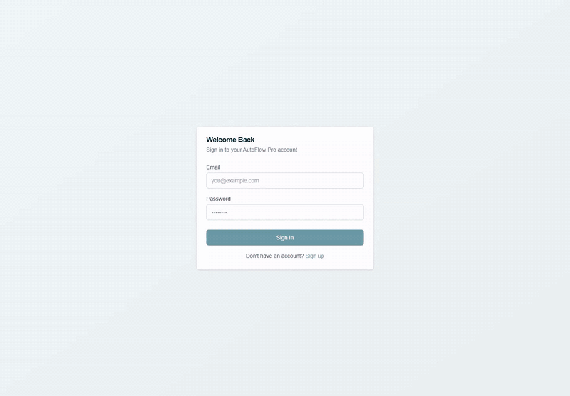
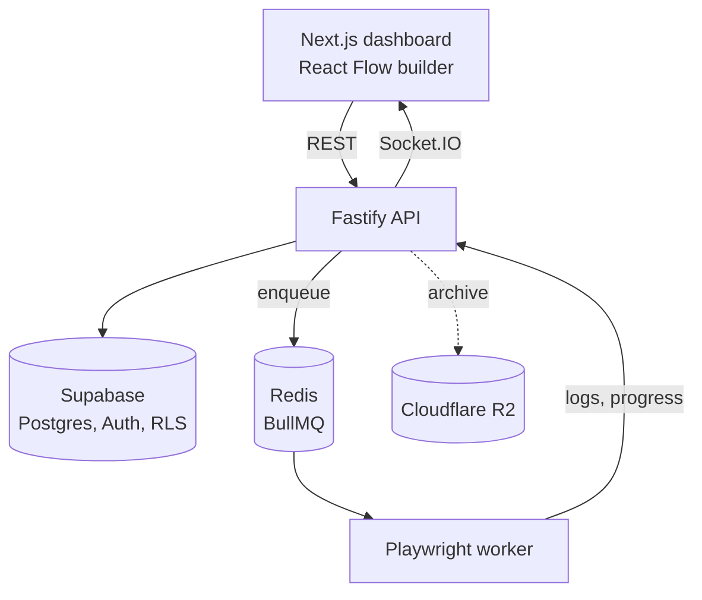

# AutoFlow Pro

Browser automation platform: drag steps onto a canvas, a Playwright worker runs them, and logs stream live.



*Recorded against a local stack (Supabase CLI, Redis in Docker, a test page served from the same machine). It plays at 2x except for the live run.*

[](https://github.com/Exalt24/autoflow-pro/actions/workflows/ci.yml) **Proof:** 23 step types, 29 backend test scripts, and CI that builds both the backend and the frontend on every push.

It runs locally with Docker and Node, and the recording above is one such run.

## What it is and why

You build a workflow out of steps (navigate, click, fill, extract, loops, conditionals), and a BullMQ queue hands it to a Playwright worker. A WebSocket pushes logs and progress to the dashboard as it runs. Jobs can run on a cron schedule and pause themselves after consecutive failures. Every row is scoped to its owner with Supabase Row Level Security. I built it to wire a visual editor, a job queue and a browser worker into one product end to end.

## What it does

- Visual builder with React Flow and 23 step types: navigate, click, fill, extract, wait, screenshot, scroll, hover, key press, run JavaScript, conditional, loop, variables, file download, drag and drop, cookies, localStorage, dropdown, right and double click.
- Cron scheduling with presets and failure monitoring.
- Live monitoring over Socket.IO with automatic reconnection.
- Analytics: execution trends, success rates, error analysis.
- Optional archival of old executions to Cloudflare R2 (off unless the R2 credentials are set).

## Architecture



## Run it

```bash
docker compose up -d redis
# a local Supabase stack, then the migration backend/migrations/001_initial_schema.sql (see docs/LOCAL_SETUP.md)
cd backend && npm install && npx playwright-core install chromium && cp .env.example .env && npm run dev
cd ../frontend && npm install && cp .env.example .env.local && npm run dev
```

Open http://localhost:3000 and sign up (a local Supabase has email confirmation off). The Supabase steps, env values and a sample workflow are in [docs/LOCAL_SETUP.md](docs/LOCAL_SETUP.md). More: [API](docs/API.md), [user guide](docs/USER_GUIDE.md), [deployment](docs/DEPLOYMENT.md), [troubleshooting](docs/TROUBLESHOOTING.md).

## Tests

CI runs `npm ci` and `npm run build` for the backend and the frontend. The 29 scripts in `backend/tests/` run with `tsx` (for example `npm run test:queue`, `npm run test:api`), print their results, and most run against a local Supabase and Redis. The frontend is checked with `npm run lint` and `npx tsc --noEmit`.

## Next steps

- The API rate limit is 100 requests per 15 minutes per client, counted in the backend process; a shared store for the counter is next, and restarting the backend clears it meanwhile.
- The usage view shows per-user quota rows (10 workflows, 50 executions a month by default); enforcing them in the backend is next.
- The data model is per-user rows with RLS; organizations and workspaces are next.
- The tests are scripts today; moving them into a test framework that CI runs is next.

## Stack

Next.js 16, React 19, TypeScript, Tailwind CSS 4, React Flow, Recharts, Fastify 5, Playwright, BullMQ, Socket.IO, Supabase, Redis, Cloudflare R2. When hosted it ran on free tiers (Vercel, Render, Supabase, Upstash).

## License

MIT, see [LICENSE](LICENSE). By Daniel Alexis Cruz, [dacruz.vercel.app](https://dacruz.vercel.app).
